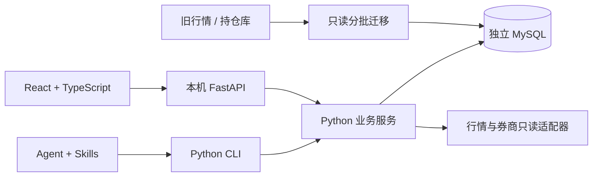

# 当前架构

Python 单包承载行情、扫描、账户、纪律和研究服务；CLI 是 Agent 的稳定入口。FastAPI 提供本机控制台适配层，React/TypeScript 只做交互与展示。MySQL 8.4 存储运行数据，Alembic 独占迁移管理。



## 目录与职责

```text
src/tradeguard/
  cli.py                  # 命令、JSON 输出、退出码
  console.py              # HTTP 适配、静态页面、扫描任务提交
  jobs.py                 # 固定每日流程
  db/                     # 模型、MySQL 锁、UTC 时间类型
  market/                 # 证券与行情、供应商、导入与质量检查
  screening/              # 可交易池、指标、策略、批次结果
  portfolio/              # 不可变快照、人工增量更新、券商适配
  discipline/             # 版本规则与确定性检查
  research/               # 报告与证据
  workspace/              # 私有工作台、自选、缓存提醒与持仓复核
  public_site/            # 固定公开市场字段的独立静态导出
web/src/                  # 本地控制台
skills/                   # 通用 Agent 操作流程
migrations/               # Alembic 迁移
scripts/                  # 一次性数据库迁移
```

这是 Python 数据项目的 src 布局；无需为了目录对称创建空 packages、apps 或 Node 后端。金融计算和行情生态采用 Python，Web 采用 TypeScript。当前没有 Kysely/Prisma：两者属于 TypeScript 数据层，强行引入会造成双模型、双迁移管理。未来独立线上服务通过版本化接口/上传契约集成，届时再选其数据层。

## 数据边界

| 表 | 职责 |
| --- | --- |
| security / daily_bar | 市场、币种、上市日期、行情；证券/交易日/来源/复权唯一 |
| bar_date_coverage / bar_series_coverage | 导入时维护的日线覆盖摘要：按市场/来源/复权/日期计数，按证券/来源/复权保存首次观察日；首页不统计日线本体 |
| job_run / run_event / scan_result | 批次、阶段事件、过滤与缺口、命中及名称/行业快照 |
| account / portfolio_snapshot | 真实账户和不可变观察；按 as_of、recorded_at 取最新 |
| rule_profile / discipline_check | 不可变规则版本、拟交易、检查结果和关联快照 |
| research_report | 正文及结构化来源证据 |
| watch_item / price_alert / notification | 本地自选与观察原因、价格条件、去重提醒与已读状态；不代表券商订单 |

金额保存 Decimal；时间以 UTC 存入 MySQL DATETIME(6)，读取恢复 UTC 时区。快照按完整 JSON 校验存储，更新创建新记录。源库仅只读；本地运行库、旧 PG 备份和远端旧库互相独立。

## 扫描流程

市场、日期、来源、复权显式选择。每股最多读取目标日前 400 根日线，禁止未来数据。先验证目标行情/历史，再做市场特定过滤，运行五个确定性策略，计算有基准证据的行业相对强度，批次保存结果与阶段事件。未知上市时间或指数缺失保持未知。历史名称/行业来自新批次的快照；旧批次缺少快照时回退主数据，不能保证任意历史时点的行业重建。输入摘要可检测变化，但尚未独立归档每次输入切片。

控制台扫描 API 默认按请求的市场、来源和复权过滤；每日历史列表显式传 `all_sources=true`，只解除来源筛选，仍固定市场、复权及非未来日期。列表按日期分组，优先展示成功/部分完成且扫描数量较多的批次，保留同日其他执行，不相加股票数、价格或信号。进入明细时携带该行的原始来源/复权与批次 ID；结果、摘要、事件、行业及图表仍严格隔离，范围不符返回 404。前端切换市场或来源后清空旧结果，并忽略失效响应。

`scan import-legacy` 只读复制旧缓存中成功完成、非未来的扫描，稳定导入 ID 保证幂等；一个批次完成校验后才在事务内保存 Run 和命中 ScanResult。保留旧执行时间、名称/行业快照与原汇总，旧候选数字不直接套作共振数，按逐股 `strategies_hit` 重计命中/共振；不覆盖当前证券主数据，不重新运行策略，不写源库。原始 provider 不明的旧记录沿用原缓存的 `legacy_mysql`/前复权边界，缺失初筛总量、过滤配置和可核验基准保留未知；原报告的环境/强度仅存作追溯，不当作已核验值。历史归档不生成缺少输入的 ScanSummary，CLI 每日报告仍读取原生扫描汇总。

`/scan` 只读取已有执行记录，不请求创建扫描所需的行情日期清单。顶部三步流程展示最新批次（或筛选日期）的已保存过滤配置和策略清单，历史列表包含命中、共振、涉及行业、共振行业与行业标签。列表用三次固定查询：读取符合范围的批次 ID/时间，在 Python 排序取最近 200 次，无序读取这些执行记录，再一次按批次/行业聚合；不逐批加载完整股票策略元数据。MySQL 即便只 SELECT id，若 WHERE 引用了庞大 JSON，filesort 仍可能携带该 JSON 耗尽排序内存，因此日期到最新批次的解析也在小字段上用 Python 排序。个股信号排序只选择 `scan_result` 字段，关联 `job_run` 仅用于范围过滤和执行时间排序。全局数据来源选择放在折叠的“数据说明”，底层范围契约和扫描到个股的截止日不变；个股账户读取独立于行情图，失败也不阻塞图表或冒充空仓。

控制台使用浅色界面：白色侧栏、固定的市场/页签顶栏、独立滚动的内容区。股票页签 URL 规范化去重但保留市场、来源、复权与截止日，不把不同历史观察合并；最多保留十个，重访不改变顺序，关闭当前页后打开相邻页。名称通过 `/api/securities/names` 一次查询最多十个证券主数据，不读取价格或账户；失败仍可用代码导航。页签支持左右滚动、完整列表与键盘导航，图表配色与界面同步为浅色。

控制台首次进入优先选取最近已保存扫描的来源/复权；没有扫描时按缓存截止日与覆盖标的数选择。显式链接和用户已选范围仍保留。来源列表展示扫描次数，无记录时可以明确切换到已有扫描的来源；不会合并不同来源的结果。`/api/scan/dates` 只返回当前市场、来源、复权下已有股票缓存的非未来日期和标的数，日历据此限制选择；无缓存的扫描请求在创建任务之前拒绝。`daily_bar` 的来源/复权/日期覆盖索引用于扫描日期与缓存检查，避免加载完整行情行；需运行 Alembic 升级。扫描列表默认收起规则与执行日志，结果图表默认开启，滚动到视区附近才异步加载，一次最多请求两张，也可手动关闭。图表请求固定使用该批次的市场、来源、复权与扫描日，行情截止所选扫描日。 市场状态按市场独立保存在浏览器内存与当前标签页的 sessionStorage 中（只存市场覆盖元数据，不存账户），刷新页面可直接恢复；60 秒内复用，过期时先展示本市场缓存并在后台更新，持久条目超过 24 小时丢弃。并发读取共用一个请求。`/api/context` 每次直接读取持久化覆盖摘要和已保存扫描活动，不依赖服务端 TTL 缓存，也不查询 `daily_bar`；显式刷新带 `refresh=true`，绕过浏览器新鲜度限制后重读摘要。首次加载时市场按钮仍可切换，旧请求不能覆盖新市场。CN/US/HK 均读取各自覆盖摘要，无行情的市场直接返回空来源。

覆盖摘要由行情写入服务拥有，与日线在同一事务内更新；旧库只读导入也维护相同摘要。`bar_date_coverage` 保存每日行数，用于历史总行数和起止日期；`bar_series_coverage` 保存每个证券/来源/复权的首次日期，用于准确计算去重标的数。两种摘要都按请求截止日过滤，未来日线不会提前成为可用覆盖。写入先按序锁定受影响的序列，只对新行情键增加日计数，重复回补与并发导入不会膨胀数量；事务失败同时回滚行情和摘要。Alembic 为既有数据做一次性本地回填；首页刷新和服务重启均不会重建摘要。首页工作台继续读取已保存的 `scan_summary`、`scan_result` 和研究报告，持仓/自选价格按证券读取少量同源最近日线。

`pipeline daily --market CN` 在同一把 MySQL 命名锁里刷新证券池、按标的断点补日线、再按交易日扫描。akshare 失败时整批改用 baostock，并写 `source_fallback` 事件；一次扫描只用一个来源。`scan_summary` 按市场、交易日、来源、复权唯一，重扫更新该行。超过 `TRADEGUARD_JOB_STALE_SECONDS`（默认 6 小时）仍为 running/queued 的 `job_run` 会被标成 stale。旧库 `mkt_bar_sync_runs` / `mkt_strategy_scan_runs` 里的 running 行不作为锁。

本机 HTTP 扫描使用有界线程池，批次状态与事件入库；这是单进程控制台，不是持久分布式队列。进程中断后的任务恢复和云端调度应在后续阶段实现。每日任务默认读缓存，明确 refresh 才联网。

## 账户与纪律

券商完整读取成功后才保存；失败保留最近成功观察。人工补丁仅合并用户明确提供的事实，保留原话、前一版本及未更新字段的观察时间。不能通过人工接口声明 broker_verified。真实计划、人工确认、券商挂单分别保存；条件触发单意图不明时不计为止损覆盖。不同币种不直接汇总，历史缓存不标为实时。

纪律检查是单账户买入/加仓评估，缺证据返回 needs_input，违规返回 blocked。跨账户风险、卖出/衍生品尚未完成。长桥基金按份额与净值归一，拆分子组合不套用全账户资产与现金；真实券商同步仍需有效凭证。应用不含下单接口。

个人工作台复用上述服务，把候选、同源扫描变化、自选、持仓退出计划复核和近期纪律检查放在一起。退出复核比较已记录止盈/止损与同源缓存收盘；保护单证据不足、快照过期或行情缺失仍为 needs_input。它不代替完整卖出策略。规则检查必须由用户明确选择规则版本与账户，没有默认套用的个人阈值。前端图表偏好与最近股票标签只保存在浏览器；标签带市场、来源、复权和历史截止日。

提醒是页面/CLI 显式触发的缓存评估，不是实时行情监控。价格条件创建当日及之后的日线才可触发，同一条件只触发一次；自选新信号和快照待更新提醒按原观察去重，不刷新行情或账户时间。CLI、HTTP 调用同一 workspace 服务。

持仓页的个人手册提醒由 `discipline.playbook` 服务读取，CLI 显式导入、`/api/discipline/playbook` 只读展示。摘要以 `portfolio_playbook_v1` 类型追加到既有 `research_report.payload`，包含来源版本和原文哈希，不复制私人经历到源码。它与 `rule_profile` 的数值执行规则分开：原文范围、趋势/价值差异与冲突可被如实展示，但不会隐式激活交易检查或替任何持仓创建条件单。首页缺口提示说明持仓时效、同源日线、退出条件及真实挂单核验各需补什么；保护单缺口保持未知。

## 部署边界

当前只在 loopback 提供控制台，阻止非本机来源的写请求；没有互联网鉴权或租户隔离。线上发布、对象存储和数据上传为后续工作，不应把当前控制台直接暴露公网。先保留本地数据与计算，后续以明确的上传协议发布脱敏结果。

已提供本地容器启动和独立公共静态导出。公开导出正向选择市场字段，不包含或连接个人状态；stock.zhiyu.hk 的线上替换暂未执行。见 [部署边界与验证](deployment.md)。

## 本地 Agent 研究报告

`research prepare` 读取明确交易日/来源/复权下的扫描，冻结完整命中池、原始策略指标、覆盖和环境；`research shortlist-save` 接收本地 Agent 的定性排序，校验每只股票及引用属于该证据包。两者复用 `research_report.payload` 的版本类型 `recommendation_evidence_v1` / `recommendation_v1`，均只追加，不需新迁移；原有正文研究保存保持兼容。重扫不改写旧报告内的事实，报告不保证历史时点可获得性，也不作为回测数据。

`workspace` 按市场、来源、复权和截止日返回最新研究报告，首页复用候选区域展示详细理由与反证。新扫描日期晚于报告时提示尚未更新。框架在 `skills/stock-analyst/references/daily-top5.md`；排序由本地 Agent 完成，Web 服务不托管模型。保存校验仅验证成员和引用，不验证自然语言事实或预测。报告执行资格固定为 needs_input，不能替代个人纪律检查。
