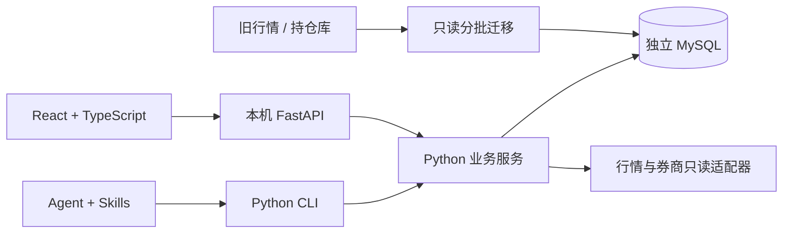

# 当前架构

Python 单包承载行情、扫描、账户、纪律和研究服务；CLI 是 Agent 的稳定入口。FastAPI 提供本机控制台适配层，React/TypeScript 只做交互与展示。MySQL 8.4 存储运行数据，Alembic 独占迁移管理。



## 目录与职责

```text
src/tradeguard/
  cli.py                  # 命令、JSON 输出、退出码
  console.py              # HTTP 适配、静态页面、扫描任务提交
  jobs.py                 # 固定每日流程
  db/                     # 模型、MySQL 锁、UTC 时间类型
  market/                 # 证券与行情、供应商、导入与质量检查
  screening/              # 可交易池、指标、策略、批次结果
  portfolio/              # 不可变快照、人工增量更新、券商适配
  discipline/             # 版本规则与确定性检查
  research/               # 报告与证据
web/src/                  # 本地控制台
skills/                   # 通用 Agent 操作流程
migrations/               # Alembic 迁移
scripts/                  # 一次性数据库迁移
```

这是 Python 数据项目的 src 布局；无需为了目录对称创建空 packages、apps 或 Node 后端。金融计算和行情生态采用 Python，Web 采用 TypeScript。当前没有 Kysely/Prisma：两者属于 TypeScript 数据层，强行引入会造成双模型、双迁移管理。未来独立线上服务通过版本化接口/上传契约集成，届时再选其数据层。

## 数据边界

| 表 | 职责 |
| --- | --- |
| security / daily_bar | 市场、币种、上市日期、行情；证券/交易日/来源/复权唯一 |
| job_run / run_event / scan_result | 批次、阶段事件、过滤与缺口、命中及名称/行业快照 |
| account / portfolio_snapshot | 真实账户和不可变观察；按 as_of、recorded_at 取最新 |
| rule_profile / discipline_check | 不可变规则版本、拟交易、检查结果和关联快照 |
| research_report | 正文及结构化来源证据 |

金额保存 Decimal；时间以 UTC 存入 MySQL DATETIME(6)，读取恢复 UTC 时区。快照按完整 JSON 校验存储，更新创建新记录。源库仅只读；本地运行库、旧 PG 备份和远端旧库互相独立。

## 扫描流程

市场、日期、来源、复权显式选择。每股最多读取目标日前 400 根日线，禁止未来数据。先验证目标行情/历史，再做市场特定过滤，运行五个确定性策略，计算有基准证据的行业相对强度，批次保存结果与阶段事件。未知上市时间或指数缺失保持未知。历史名称/行业来自新批次的快照；旧批次缺少快照时回退主数据，不能保证任意历史时点的行业重建。输入摘要可检测变化，但尚未独立归档每次输入切片。

本机 HTTP 扫描使用有界线程池，批次状态与事件入库；这是单进程控制台，不是持久分布式队列。进程中断后的任务恢复和云端调度应在后续阶段实现。每日任务默认读缓存，明确 refresh 才联网。

## 账户与纪律

券商完整读取成功后才保存；失败保留最近成功观察。人工补丁仅合并用户明确提供的事实，保留原话、前一版本及未更新字段的观察时间。不能通过人工接口声明 broker_verified。真实计划、人工确认、券商挂单分别保存；条件触发单意图不明时不计为止损覆盖。不同币种不直接汇总，历史缓存不标为实时。

纪律检查是单账户买入/加仓评估，缺证据返回 needs_input，违规返回 blocked。跨账户风险、卖出/衍生品尚未完成。长桥基金按份额与净值归一，拆分子组合不套用全账户资产与现金；真实券商同步仍需有效凭证。应用不含下单接口。

## 部署边界

当前只在 loopback 提供控制台，阻止非本机来源的写请求；没有互联网鉴权或租户隔离。线上发布、对象存储和数据上传为后续工作，不应把当前控制台直接暴露公网。先保留本地数据与计算，后续以明确的上传协议发布脱敏结果。
