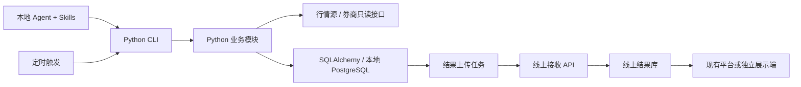

> 历史规划：本文件保留早期范围与取舍。当前实现以 docs/architecture/README.md、迁移和代码为准；运行库已改为 MySQL，已加入本地 Web 控制台。

---
status: in_progress
human_reviewed: false
date: 2026-10-18
---

# 股票研究与交易纪律独立仓库方案

本文是 AI 候选技术方案，未代表本人最终裁决。项目名 TradeGuard。用户于 2026-10-18 授权在 /Users/bouda/work/tradeguard 开始编码；目前已实现首版本地闭环，实际能力与验证见 docs/architecture/README.md 和 docs/verification.md。本文未完成项仍为计划，不作为运行态事实。

## 当前第一期范围（用户 2026-10-18 补充）

先完成本地 Python CLI、Skills、数据库直连，API/Web/线上上传延后。按授权复制 myskills 中已有配置并验证；只读复用 stock-scanner 的线上市场 MySQL 数据到独立本地库，避免重新整池抓取。本文下方线上架构均为后续草案，不属于第一期验收。

## 1. 目标与边界

用户要求：将 stock-analyst、trading-discipline、stock-scanner、portfolio-tracker 和相关投资资料拆为独立 Git 项目；以 skills + 工具支持咨询、股票数据同步、购买前纪律检查；复用 selection 每日扫描经验，最初参考 ruyi 并讨论 Prisma/Kysely，最新要求是摆脱现有架构约束、重新按业务选择语言与标准目录；本地 Agent 驱动执行，部分结果存线上展示。

建议形成四条闭环：

1. 每日行情同步 → 数据质量检查 → 策略扫描 → 候选池和板块汇总。
2. 用户提问 → 查询行情/财务/一手来源 → 研究报告及证据。
3. 拟交易 → 刷新持仓/挂单 → 确定性纪律检查 → Agent 解释、补问 → 交易卡。
4. 本地结果 → 可恢复上传 → 线上查看日期、结果、证据和异常。

首版不做自动下单、云端自主交易、复杂回测平台、收费多租户 SaaS、自建聊天产品。线上展示先规定数据接口与访问边界，页面设计另行展开。

## 2. 已核对的现状

参考项目实际路径为 `/Users/bouda/work/selection`（HEAD `6dfbe07`）与 `/Users/bouda/work/ruyi`（HEAD `48700a7`）；并不在当前仓库的相邻目录。版本号是本次参考定位，不表示其工作区无未提交改动。

| 资产 | 可复用内容 | 必须改变的部分 |
| --- | --- | --- |
| skills/stock-analyst | 产业链、评分卡、一手来源目录 | 相对路径、工具契约、研究证据落库 |
| skills/trading-discipline | 分支流程、规则解释、交易卡 | 个人经历与通用规则分开，参数配置化，接入结构化检查 |
| tools/stock-scanner | 六类策略实现、数据源适配、增量扫描 | 统一持久层、硬编码路径、数据口径 |
| tools/portfolio-tracker | 券商适配、持仓/挂单标准化、仓位拆分、检查 | 统一持久层、个人种子数据、快照完整性 |
| selection | full_update.py → run_scan.py、初筛、板块共振、测试 | SQLite 直接读写、旧部署脚本、模拟仓不能当真实仓 |
| ruyi | 事务、迁移、测试边界等工程经验 | 不沿用 apps/packages 目录或 Kysely 技术选型，不带入无关业务 |
| inverst | 手册可提炼为规则示例，公开介绍可单独整理 | 不整体迁移；复盘、截图、真实账户和私人经历不进入开源默认包 |

具体发现：

- scanner 使用 SQLAlchemy，支持 selection SQLite/baostock → 长桥 → 富途；selection 的 `scripts/run_daily.sh` 默认 `STOCK_DATA_PROVIDER=akshare`。二者不能简单认定同一条流水线。
- selection 有 Prisma schema，但当前同步/扫描入口仍出现 sqlite3 直接读写；新项目需迁移实际读写链路，不沿用两套数据库管理方式。
- selection 定时脚本注释写凌晨 2 点，setup.sh 安装项写 9 点。本次只验证了代码，未核验机器实际 crontab、远端任务或最近成功日志。
- scanner 的 `get_expected_last_trading_day` 是工作日近似，缺交易所节假日日历。
- portfolio-tracker 的同步异常分支仍 commit 已加入 session 的记录；新实现必须防止失败批次被用作完整快照。
- `planned_stop` 被现有检查认可，但它与券商实际有效条件单不是同一证据等级。
- 部分源码带旧机器绝对路径；README、seed、脚本及图片也需开源清理。

## 3. 重新选型：Python 主体，按业务组织单包

### 3.1 判断依据

产品核心是日线数据采集、时间序列计算、账户同步、纪律检查和 Agent 工具调用。没有低延迟交易撮合、高频执行或复杂在线协作需求。语言应首先服务这些工作负载，不能因参考项目用了 TypeScript 就增加跨语言后端。

这里区分事实与判断：pandas 提供时间序列处理能力，SQLAlchemy 支持批量 DML 和 PostgreSQL upsert，Kysely 是 TypeScript 查询构建器，均可由官方文档核对；“本项目选 Python”是基于这些能力与当前需求的工程判断，不是语言性能测试结论。

| 方案 | 适用优势 | 本项目承担的成本 | 结论 |
| --- | --- | --- | --- |
| Python 全部核心业务 | 行情清洗、时间序列、数值库及现有券商接入可在同一进程组合；CLI/API 可共用逻辑 | 需类型检查、运行时校验；计算任务需与 API 隔离执行 | 推荐 |
| TypeScript 全部核心业务 | 编译期约束和 Web 开发体验；纯 HTTP 数据源接入也可直接完成 | 所需策略/数据 SDK 要重写或重新验证；未来研究计算生态的接入成本 | 如果未来主体变成 Web 协作产品，可再评估；目前收益不足 |
| TypeScript 后端 + Python 计算进程 | 两边各用所长，可独立扩容 | 两套依赖/契约、序列化、大数据传输、失败恢复和跨进程排错 | 当前规模不采用 |

这不是“股票必须用 Python”：浏览器交互适合 TypeScript，极低延迟交易可能需要其他语言。本项目选择 Python 的原因是工作负载和生态匹配；已有 Python 代码降低迁移成本只是附加收益。

### 3.2 推荐技术栈

| 职责 | 选择 | 原因与限制 |
| --- | --- | --- |
| 业务与工具 | Python，单个可安装包 | CLI、任务、API 复用模块，无跨语言数据库代理 |
| 项目与依赖 | pyproject.toml + uv.lock | 明确入口、依赖与可复现安装；SDK 兼容测试后固定 Python 小版本 |
| CLI | Typer | 为 Agent 和人提供同一套命令；JSON 输出为稳定契约 |
| 输入与输出 | Pydantic | 校验外部输入与返回结构，导出 JSON Schema；纯计算内部使用类型化数据结构 |
| 行情与策略 | pandas + NumPy | 延续向量化计算，先测再决定是否引入 Polars 或进程并行 |
| 数据库 | PostgreSQL | 行情、快照、规则、任务及上传记录统一存储与事务 |
| 数据访问 | SQLAlchemy 2 + psycopg | 普通实体使用 ORM；批量写入、聚合采用 Core，必要时参数化 SQL |
| 结构迁移 | Alembic | 模型描述结构，迁移记录变更；自动生成的迁移必须审查 |
| 线上接收/查询 | FastAPI，可选依赖 | 和 CLI 调用同一业务服务；不在 HTTP 请求内运行全市场扫描 |
| 质量工具 | pytest + Ruff + mypy | 行为回归、静态检查与明确类型；动态输入仍由 Pydantic 校验 |
| 展示 | 优先接现有平台；自建时 web/ 用 TypeScript | 不为展示引入第二套后端和 ORM；具体界面框架等页面需求确定后再选 |

SQLAlchemy Core 提供所需的 SQL 表达空间，选择 Python 后不再引入 Kysely 或 Prisma。用户允许重新评估语言和架构，因此本草案也重新评估数据库工具；不是把 Kysely 当作硬性要求。最终栈仍属于待确认方案。

依赖按能力安装：基础包含 CLI/数据库/规则；行情扫描、具体券商 SDK、API 为可选依赖组，按需加载。不要因为某券商未配置就阻止整个 CLI 启动。遇到 SDK 对 Python 版本或依赖有硬冲突，再隔离该适配器，默认不建独立服务。

### 3.3 目录：生态惯例 + 业务模块

不存在一个跨所有技术栈的“唯一业界标准目录”。采用 PyPA 文档说明的 src layout 与 pyproject.toml；内部按业务归属组织。这是一种常见、可安装、可测试的单包结构，不照搬大型平台分层。

下面只列一期本地闭环会实际使用的目录；实际建仓时不创建空占位目录，Python 子包包含必要的 __init__.py。

```text
tradeguard/
├── pyproject.toml             # 项目、依赖组、tradeguard 命令入口
├── uv.lock
├── README.md
├── LICENSE
├── AGENTS.md
├── .env.example
├── .gitignore
├── compose.yaml               # 本地 PostgreSQL
├── alembic.ini
├── src/
│   └── tradeguard/
│       ├── __init__.py
│       ├── cli.py             # 命令入口，仅做解析与输出
│       ├── config.py          # 环境/用户配置、路径与能力开关
│       ├── market/            # 证券、交易日历、行情采集与质量
│       ├── screening/         # 指标、策略、候选池与板块汇总
│       ├── portfolio/         # 账户、券商接入、持仓与挂单快照
│       ├── discipline/        # 规则版本、拟交易与检查结果
│       ├── research/          # 研究报告、证据与引用
│       ├── db/                # 连接、SQLAlchemy 模型、查询与事务
│       └── jobs.py            # 每日流程、互斥、重试、恢复
├── migrations/               # Alembic env 与版本记录
├── skills/
│   ├── stock-analyst/
│   └── trading-discipline/
├── tests/                    # 按业务模块对应组织；含合成 fixtures
├── examples/                 # 脱敏配置与交易卡样例
└── docs/                     # 架构、安装、数据口径和方案
```

线上功能实施时再增加：

- `src/tradeguard/publishing.py`：上传、幂等、重试；变大后再拆成包。
- `src/tradeguard/api/`：FastAPI 入口、鉴权和路由；如果已有平台完成接收与查询，则无需自建。
- `web/`：只有自建独立前端才创建，使用自己的 package.json 和 pnpm-lock.yaml；无需根级 pnpm workspace。
- `Dockerfile`：真正容器化部署时再加；CI 配置在建仓并确定托管平台后添加。

不创建 apps/、packages/、tools/python/、domain/、application/、contracts/、infra/、docker/ 或通用 utils/ 占位目录。源码是可安装的工具本体，tools/ 不再放另一套产品实现。不引入微服务、消息队列、向量库或自研 Agent runtime。

### 3.4 模块如何分工

CLI/API → 对应业务模块的 service 函数 → db 查询或供应商 adapter。纯策略、规则函数不依赖数据库、网络或 CLI。

例如 market 模块可从 service.py、schemas.py、providers/ 起步；screening 内包含 strategies/；portfolio 内包含 brokers/。只有文件职责已经出现才拆，不要求每个模块复制一整套模板。数据库查询按业务放在 db/market.py、db/portfolio.py 等，统一迁移与事务实现。

服务函数决定事务边界，db 查询不自行随意 commit；CLI 不直接写 SQL，策略不查询当前系统时间或隐式拉取最新行情。外部输入用业务模块自己的 schemas.py 校验，不建立跨语言 contracts 包。

初期使用同步数据库访问和明确的事务上下文；阻塞 I/O 有界并发，CPU 密集扫描可在独立任务进程运行。任务进程与 API 是同一 Python 包的不同运行入口，不需要先拆仓或拆服务。

金额与数量在存储、规则比较中使用 Decimal/数据库 NUMERIC；指标计算可用 NumPy 浮点并指定误差容限。股票代码字符串保留前导零，携带市场和币种。类型、校验与测试共同防错，不能依赖 Python 注解自动保证运行时正确。

### 3.5 数据库迁移约定

`db/models.py` 描述预期结构，`migrations/versions/` 记录正式演进，运行态不调用 create_all 代替迁移。Alembic autogenerate 只是候选，尤其重命名、数据回填与约束变更需审查。表字段保留业务注释。

`docs/data-model.md` 解释实体关系；没有实际使用者需求时不额外维护 schema.sql，避免多份手工结构文件。CI 从空 PostgreSQL 应用迁移、从受支持旧版本升级并检查 metadata 一致性。旧 SQLite/MySQL 的读取仅用于一次性导入，正式运行首版只支持 PostgreSQL，减少兼容矩阵。

### 3.6 技术依据

- [PyPA：src layout](https://packaging.python.org/en/latest/discussions/src-layout-vs-flat-layout/) 与 [pyproject.toml](https://packaging.python.org/en/latest/guides/writing-pyproject-toml/)：支持本项目的可安装单包组织。
- [uv 项目文件](https://docs.astral.sh/uv/concepts/projects/layout/)：依赖与锁文件管理。
- [pandas 时间序列](https://pandas.pydata.org/docs/user_guide/timeseries.html)：时间索引、重采样、日期等能力；不代表行情口径自动正确。
- [SQLAlchemy 批量 DML](https://docs.sqlalchemy.org/en/20/orm/queryguide/dml.html) 与 [PostgreSQL 支持](https://docs.sqlalchemy.org/en/20/dialects/postgresql.html)：批量与 upsert 能力。
- [Alembic 自动迁移限制](https://alembic.sqlalchemy.org/en/latest/autogenerate.html)：生成结果需要审查。
- [FastAPI 多文件应用](https://fastapi.tiangolo.com/tutorial/bigger-applications/)：支持单包内模块化路由，无需多包架构。
- [Kysely 定义](https://kysely.dev/docs/intro)：它服务 TypeScript SQL 访问；本方案没有相应运行时需求。

### 3.7 容量与性能如何验证

首版范围是日线扫描和账户管理，不预设 tick/分钟级全市场存储。举例按 6,000 只证券、250 个交易日、10 年估算约 1,500 万条日线（容量算例，不是当前实际证券数）；不据此直接引入专用时序库。先用 PostgreSQL、合适的唯一键/索引、分批写入与按扫描范围读取，验证实际吞吐和内存。

P0/P1 使用冻结数据测量单股、100 只样本和全池扫描的耗时、峰值内存、数据库读写量及候选结果一致性；网络采集耗时与计算耗时分开。计算按证券分批，避免整个历史库一次装进 DataFrame。性能验收目标根据机器和每日可用执行窗口确定，本次尚未做基准测试。

Parquet 可在确有重复历史研究需求时作为不可变输入切片/导出格式；DuckDB、TimescaleDB、ClickHouse 等留待分钟数据或分析瓶颈出现后再评估。它们不在一期依赖清单中。

## 4. 本地与线上数据职责



本地主库保存完整行情、私人账户、完整快照、规则、研究过程及结果。线上库保存可重建的展示副本。首版本地是唯一业务写入方，线上不编辑规则和持仓，避免双向冲突同步。

线上默认上传：扫描批次、候选结果、板块汇总、用户选择的研究报告。账户/持仓/纪律报告需配置启用私有同步，并要求登录；公众展示仅允许明确标记公开的数据。券商凭证、个人经历、原始聊天不上传。开源代码与公开数据是不同动作；数据源授权不明确时不开放原始行情下载。

上传不是数据库复制：本地提交结果与待上传任务在同一事务写入；任务包含稳定 UUID、内容版本、摘要、拥有者和数据等级。服务端按拥有者+对象 ID+版本幂等写入，冲突内容拒绝覆盖；成功确认后本地标记完成。失败指数退避，重启续传；先上传批次内容，验收行数/摘要后才激活展示版本。失败上传不阻塞本地查询与纪律检查。

首版一个实例服务一个拥有者；API 从令牌确定拥有者，不信任请求中的 ownerId。公开端点只读公开投影，绝不通过隐藏前端菜单保护私人信息。正式多租户隔离留待独立需求。

## 5. 命令与 Agent 边界

以下都是待实现契约，不是现成命令：

```text
tradeguard doctor
tradeguard market sync --market CN --date YYYY-MM-DD
tradeguard market quality --run <id>
tradeguard scan run --market CN --date YYYY-MM-DD
tradeguard scan results --run <id> --json
tradeguard portfolio sync
tradeguard portfolio report --json
tradeguard discipline check --intent intent.json --json
tradeguard research save --file report.json
tradeguard pipeline daily --market CN
tradeguard publish flush
```

每个命令支持机器可读结果：schemaVersion、runId、status、asOf、data、warnings、errors；状态含 success/partial/failed/needs_input，业务拒绝与执行故障分开。大结果只返回统计、分页入口或 artifact 路径。

Agent 负责理解问题、选择工具、研究推理、解释结果。工具负责算指标、同步、规则判断与落库。Agent 不能凭文字绕过规则，也不能把模型生成的价格当报价。规则命中返回 ruleId、规则版本、输入证据、阈值、结果和缺口。

日常交互由本地 Agent 调用 CLI；每日固定任务建议由系统调度直接运行同一条 `pipeline daily` 命令，Agent 查看结果、分析异常或按需补跑。如果用户要求所有触发都经 Agent，也只由 Agent 调用该命令，流水线顺序和重试仍由代码负责。首版不自建 LLM 运行时，使用现有支持 skills/CLI 的 Agent 宿主。购买前是咨询检查，不提供执行下单能力。

## 6. 数据模型与口径

一期按独立生命周期保留以下对象，避免每个小字段另建一张表：

| 对象 | 关系、拥有者与用途 |
| --- | --- |
| Security / DailyBar | 公共市场域；证券 1:N 日线；保留历史，不随自选删除 |
| JobRun / ScanResult | 拥有者下的批次与 1:N 结果；记录日期、版本、覆盖率、数据集摘要；旧批次保留 |
| Account / PortfolioSnapshot | 私有账户与 1:N 完整同步批次；账户停用不删除历史 |
| PositionSnapshot / OrderSnapshot | 快照下 1:N 持仓/挂单；跟随批次生命周期，真实空仓与接口失败分开 |
| PositionLot / WatchlistItem / JournalEntry | 私有仓位角色、自选与操作日志；沿用已有能力，日志追加 |
| RuleProfile / TradeIntent / DisciplineCheck | 私有规则版本、拟交易和检查记录；检查绑定不可变规则及持仓快照，禁止改写历史结果 |
| ResearchReport / ResearchEvidence | 报告及 1:N 证据；保留来源、观测期、披露时间、抓取时间和引用关系 |
| Publication | 待上传对象、版本、重试和服务端回执；成功后可按保留期清理 |

JobRun 可存汇总 JSON（策略配置、板块汇总、失败项）；首版不另建策略目录表、板块汇总表、通用事件总线。大规模逐证券失败清单确有需要时再细化。

行情必须统一证券市场代码、交易日期、币种、成交量单位、复权方式、来源及抓取时间。建议日线唯一键为证券+日期+复权方式+来源；扫描清单明确本次选择的数据版本，不能拼接不同供应商的价格口径。价格和金额用 Decimal，序列化成十进制字符串；Python 数值计算容许误差但必须有对照阈值。

前复权序列会因公司行动发生历史变化，不能永远只追加最新一根；检测到变化时刷新受影响区间、作废相关缓存并重扫。扫描绑定数据摘要和策略版本；需要完全复现的批次保留压缩输入切片及参数，避免只存 hash 却找不回原数据。

持仓同步在拉完并验证账户资产、持仓、挂单后提交完整快照，再原子切换当前快照。失败批次可留诊断，不能成为“最新底牌”。规则检查必须标明快照时间，过期或缺数据返回 needs_input。

止损证据分成 planned / manually_confirmed / broker_verified，另检查挂单状态、数量和有效期；“填过价格”不等于券商已生效。拟交易检查计算交易后的敞口，不能只查交易前比例。

规则阈值来自个人 RuleProfile；现有 2%、25%~30% 等只是用户个人规则，开源时明确为可替换示例，不能变成所有用户默认接受的投资原则。跨币种统一换算时保留汇率来源和时间；缺汇率就分桶展示，不给全账户通过结论。

## 7. 每日数据流水线

统一步骤：交易日历 → 股票池/行业更新 → 增量行情 → 质量检查 → 扫描 → 板块汇总 → 生成结果 → 上传。

- A 股调度时区固定 Asia/Shanghai，其他市场使用对应交易所日历和时区；事件时间统一存 UTC，executionAt 与 marketDate 分开，凌晨补跑应对应上一已完成交易日。
- 使用真实交易所日历，不以周一至周五代替；初期建议收盘后运行，具体时间按供应商实际数据就绪情况确定。
- 先对 AKShare/baostock 做同股票同日期口径对照，选定默认源；长桥/富途作为显式可配置补充，有额度上限，切换记录原因。
- 质量报告列出应有/成功/停牌/新股历史不足/失败数量；校验 OHLC、重复、日期、新鲜度、单位和复权口径。部分完成不能包装成全市场扫描成功。
- 历史长度由策略所需 bar 数+预热期决定，不把“120 自然日”当成“120 交易日”。
- 互斥租约避免 Agent 与定时任务重复跑；幂等键含市场、目标日期、策略配置版本和数据版本；显式重跑产生新 revision。
- 本地睡眠/断网时任务不会准点完成。开机恢复后补跑最近缺失交易日；若必须保证每天准点，需要常开主机，这是部署条件。
- 首版不引入 Redis/Celery；本地单执行器+任务表足够。跨主机并发出现后再扩展。

## 8. 拆仓与开源

以白名单复制到新私有 Git，完成清理后再公开。推荐新历史起步，不直接把 myskills 全量 Git 历史带过去；保留来源版本和必要版权说明。先核对被复用代码及数据源的许可证，不预先认定可以采用某种许可证。

公开：通用 skills、策略、适配器、契约、测试、合成 fixture、配置示例、架构文档。私人规则与真实账户存本地数据库，私人长文存被忽略目录；不给程序内置布达账户和经历。

特别检查 seed_data.py、迁移脚本、券商指南、README、日志、数据导出、截图、PPT/PDF、提交历史中的账号、地址与凭证。inverst 不整体复制；手册共性提炼后去重到 skills，复盘和黑客松材料默认留在原仓库。

myskills 中保留新仓库安装指引；本地技能发现层可链接新仓库 skills。长期真源只保留一份，不同时维护两套技能文本。

## 9. 分阶段执行与验收

| 阶段 | 工作 | 完成标准 |
| --- | --- | --- |
| P0 清点与基线 | 列搬迁清单、脱敏、核对源许可、固化策略及样例输入 | 无真实私密数据的 fixture 可复现现有结果，明确策略差异 |
| P1 独立骨架 | 新仓库、uv、Python 单包、SQLAlchemy/Alembic/Postgres、CLI、通用 skills | 新机器按 README 起库并跑一只股票的完整闭环 |
| P2 每日扫描 | 迁移取数、日历、质量门、五个主扫描策略及板块共振；第六策略保留可选 | 同一冻结数据的新旧结果差异逐项解释；重复/中断重跑不重复入库 |
| P3 持仓与纪律 | 券商适配、完整快照、人工导入、规则配置、拟交易检查 | 空仓/失败可区分；失败不覆盖快照；过期/缺汇率/假止损不放行 |
| P4 研究与线上结果 | 报告证据、上传任务、鉴权、读取 API；展示页面另做原型 | 断网可本地用，恢复不重复上传；私人结果不可匿名读取 |
| P5 切换与开源 | 数据导入、运行对照、切换旧定时任务、安装文档、许可证 | 至少连续五个交易日对照通过；清理检查和干净安装通过 |

旧数据迁移：先备份与只读导出，证券标识/币种/复权归一，SQLAlchemy 分批导入；对比各表行数、日期范围、持仓数量、逐币种金额与抽样 hash。selection 模拟持仓标记 simulation，与 broker/manual 的真实持仓分离，首版可不导入模拟仓。

切换采用单写：验证期旧工具继续生产，新工具读取冻结导出/独立库比对；通过后关闭旧调度，启用新调度。不得两套同步器互相覆盖同一库。回退保留旧库与旧入口，新系统产生的私人记录先导出归档再回退，避免丢失切换期间数据。

需要的测试：适配器契约、冻结行情策略对照、真实 PostgreSQL 迁移/事务集成、纪律反例、上传幂等与鉴权。模拟券商用于常规测试，真实接入做只读冒烟；测试不连真实券商下单。

本次是规划，没有执行代码测试、同步账户、创建新 Git 或改变运行任务。

## 10. 当前建议与待定项

建议默认：工作名 TradeGuard；本地 PostgreSQL 主库、线上结果副本；Python 统一业务与持久化，SQLAlchemy + Alembic；TypeScript 仅在独立 Web 前端需要时引入；现有 Agent 宿主驱动；先扫描和纪律闭环再展示。

待实施前确定：Python 主栈方案是否接受；正式仓库名与许可证；本地常开机器；线上是已有平台接入还是本项目自带 API/Web；私人持仓是否上云；线上公开哪些报告。未确定这些不妨碍先完成 P0/P1，但不可据此自动公开仓库或私人数据。
